<div align="center">



<br>

[](https://addons.mozilla.org/firefox/addon/tomo/)
[](https://chromewebstore.google.com/detail/tomo/ejdlbopdblhemopclkioijjcnmlbenfp)
[](#install)
[](LICENSE)

**Free, no limits, no ads, no account.**

Right-click a video, an audio player or an image, and Tomo saves the original file or copies what is said as text.

[Features](#features) · [Chrome and Firefox](#chrome-and-firefox) · [Install](#install) · [Use](#use) · [FAQ](FAQ.md) · [Report a problem](#report-a-problem)

</div>

---

## Features

- **Original quality.** Video and audio as the site offers them, with title, author and cover.
- **Full-size images.** Tomo looks for the gallery original and saves its bytes unchanged. You can also convert to PNG, JPG or WebP at full, 75% or 50% size.
- **Video to text.** Copy what is said in about a second, or save it as TXT or SRT.
- **Your favourite format.** Choose it once and it appears at the top of the menu.
- **Light.** Nothing runs in the background, apart from a short update check.
- **Private.** Downloads stay on your computer. The optional AI features (text summaries, image enhancement) use your own API key and ask for your consent first. They send content only to the provider you choose.
- **11 interface languages.** English, Español, Português, Français, Deutsch, Italiano, Русский, Polski, Türkçe, 日本語 and Română. Some secondary Romanian messages are still in English.

## Chrome and Firefox

Tomo ships as two builds from the same code. Each store listing describes only its own build.

| | Firefox | Chrome, Edge, Brave |
|---|---|---|
| Get it | [Firefox Add-ons](https://addons.mozilla.org/firefox/addon/tomo/) | [Chrome Web Store](https://chromewebstore.google.com/detail/tomo/ejdlbopdblhemopclkioijjcnmlbenfp) |
| Minimum version | Firefox 140 | Chrome 116 |
| YouTube | Yes | No |
| Other sites | Vimeo, Reddit, TikTok, X, SoundCloud, news sites and more | Same, except YouTube |
| Extension type | Manifest V2, background page | Manifest V3, service worker |
| Image variants for YouTube pages | Yes | No |
| Permissions | Helper messaging, menus, notifications, storage, active tab, downloads, content script on all sites | The same, plus scripting and alarms (for the video check and the engine update timer), and two content scripts |
| Engine updates | Timer in the background page | Alarm, every few days |
| AI consent | Handled by Firefox's data-collection prompt | Tomo shows its own consent prompt and stores your answer |
| Helper (Windows 10/11) | Required for video, audio and text | Required for video, audio and text |

Why no YouTube on Chrome: the Chrome build and its helper reject YouTube hosts on purpose. If you need YouTube, use the Firefox build.

## Install

Two parts: the extension in your browser and a small helper on your PC that saves the files. Each is installed once.

### 1. Add the extension

- Firefox: [Add Tomo from Firefox Add-ons](https://addons.mozilla.org/firefox/addon/tomo/)
- Chrome, Edge, Brave: [Add Tomo from the Chrome Web Store](https://chromewebstore.google.com/detail/tomo/ejdlbopdblhemopclkioijjcnmlbenfp)

### 2. Add the helper (Windows 10/11)

> **Release setup pending.** The pinned installer refuses to run until a signed release is published and its verification key is configured. Do not bypass signature verification.

1. Press the Windows key, type `PowerShell` and press Enter.
2. Paste this line and press Enter:

```powershell
irm https://raw.githubusercontent.com/C-Rosende/Tomo/v0.7.12/get.ps1 | iex
```

3. Wait until it says **Done**. The first run takes a few minutes. Then click the Tomo icon in your browser; it finds the helper by itself.

It installs in your own user folder and needs no administrator rights. Run the same line again to update.

<details>
<summary>Text for videos without subtitles (optional, about 300 MB)</summary>

```powershell
& ([scriptblock]::Create((irm https://raw.githubusercontent.com/C-Rosende/Tomo/v0.7.12/get.ps1))) -WithASR
```
</details>

macOS and Linux are not supported yet. [Help us test](#help-wanted).

## Use

1. Right-click a video or an image.
2. Choose **Download or transcribe**.
3. Pick **Video**, **Audio** or **Text**. For images, choose **Save image**, then a format or size.

Files go to your Downloads folder and never overwrite anything.

- Toolbar button: quality, format, image options, audio language and your downloads.
- **Download in my format** is the first menu item.
- On sites with their own right-click menu, hold Shift while you right-click.

More in the [FAQ](FAQ.md).

## Privacy

- No account, no ads, no statistics.
- Tomo contacts the site you asked it to download from, PyPI to keep yt-dlp up to date and, only if you turn it on, your AI provider.
- It reads your cookies only if you turn on **Use my session**, which is off by default.
- It does not bypass copy protection or DRM, so services such as Netflix or Disney+ will not work.

Read the [privacy policy](PRIVACY.md) and the [permission list](docs/permissions.md).

## Update and uninstall

- Helper: run the install line again.
- A site stopped working: Tomo, then **Settings**, **Advanced**, **Update yt-dlp**.
- Uninstall: remove the extension, then run `uninstall.ps1`. Your downloads stay.

## Report a problem

1. Tomo button, **Settings**, **Report a problem**.
2. A form opens with your system, browser, Tomo version and component version filled in. Tomo also copies a short, private diagnostic report to your clipboard. Review it and paste it into the **Report** box.
3. Describe what happened, then submit. Diagnostics and screenshots are optional; remove private information before sharing either.

Opening the form shares only your system, browser and the two version numbers, never the pages you visit. The report holds versions, component availability and an error count, never addresses, titles or files. Nothing is sent until you paste and submit it.

Ideas and questions: [open an issue](https://github.com/C-Rosende/Tomo/issues/new/choose). Security problems: see [SECURITY.md](SECURITY.md) and never use a public issue.

## Help wanted

- People on macOS or Linux to test the install scripts.
- Translations, and testing on more sites.

Read [CONTRIBUTING.md](CONTRIBUTING.md) first. Everyone follows the [Code of Conduct](CODE_OF_CONDUCT.md).

## Support

Tomo is free and stays free. If it helped you, you can say thanks on [Ko-fi](https://ko-fi.com/crosende). Nothing is locked behind it.

## Licence and legal

Tomo is not open source. Its runtime code is readable in the extension packages and helper download; development is maintained separately. The [PolyForm Strict License 1.0.0](LICENSE) permits specified noncommercial uses and does not grant permission to distribute or modify the software. Read its terms before using it. Version 0.6.4 was published under MIT and stays under it.

The Tomo name, logo and icons are not covered by any licence, including MIT for 0.6.4. They may not be used in copies, forks or derivative works; anything built from this code must use a different name and its own branding.

Download only what you have the right to download, and respect each site's terms. This project does not circumvent DRM or access controls. You use it at your own responsibility and without warranty. See the [terms of use and disclaimer](docs/TERMS.md) (English and Spanish; not legal advice).
