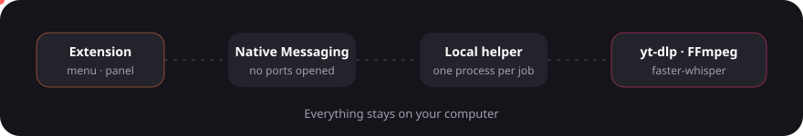

# Technical notes

For people who want to understand, build or change Tomo. If you only want to use it, the [README](../README.md) is enough.

## How it works



The extension cannot save videos by itself, so it talks to a small local program (the helper) through the browser's Native Messaging. The helper uses [yt-dlp](https://github.com/yt-dlp/yt-dlp) and FFmpeg. It supports everything yt-dlp supports (1,800+ sites), plus direct files and public HLS/DASH streams on any page. Sites that block plain scripts are retried with a browser-like connection. Sites that need a login work with the optional *Use my session* switch.

### What the install line puts on the computer

Everything goes into the user folder. No administrator rights, nothing runs in the background.

| Piece | What it does | Where it comes from |
|---|---|---|
| **Tomo helper** | Connects the extension to the tools below | This repository |
| **yt-dlp** | Finds and downloads the video | Its official release, in a private Python environment |
| **FFmpeg** | Joins audio and video, converts formats | `winget`, only if missing |
| **Deno** | Lets yt-dlp read YouTube pages | `winget`, only if missing |
| **Python** | Runs yt-dlp | `winget`, only if missing |
| **Speech to text** (optional) | Transcribes videos without subtitles | Downloaded once, on request |

The installer tests itself and goes back to the previous version if anything fails. `verify.ps1` checks the installation and `uninstall.ps1` removes it.

## Two packages, one codebase

| Package | Browsers | YouTube | Built from |
|---|---|---|---|
| `tomo-firefox-<version>.zip` | Firefox 140+ (Manifest V2) | Yes | `extension/` |
| `tomo-chrome-<version>.zip` | Chrome, Edge, Brave (Manifest V3) | **No** | `extension/` + `chrome/` |

`node tools/build.js` writes both to `dist/`. The Chrome package is `extension/` with the files in `chrome/` laid over it:

| File | Role |
|---|---|
| `chrome/manifest.json` | Manifest V3: service worker, `action`, `scripting`, `alarms` |
| `chrome/sw.js`, `chrome/compat.js` | Loads the shared scripts in the service worker and maps Firefox names (`browser`, `menus`, `browserAction`) |
| `chrome/platform.js` | Replaces `extension/platform.js`: probing, page detection and timers for Chromium |
| `chrome/probe-listener.js` | Remembers the right-clicked element, because Chromium has no `getTargetElement` |

`extension/platform.js` and `extension/probe.js` hold the few places where browsers differ. Everything else is shared. Fix bugs in the shared code once.

### Why the Chrome package has no YouTube

This is a deliberate product decision for the Chrome Web Store version. It is enforced twice: the helper refuses YouTube addresses when the caller is a Chromium extension (`CHROMIUM_CLIENT` in `backend/host.py`), and the message tells the user to use the Firefox version.

### Native Messaging for Chromium

Chromium needs the exact extension ID in the helper manifest (`allowed_origins`, no wildcards). The published Chrome Web Store ID is `ejdlbopdblhemopclkioijjcnmlbenfp` in [`chromium-ids.txt`](../chromium-ids.txt). `install.ps1` writes `native-host-chromium.json` and registers it for Chrome, Edge and Brave under `HKCU`. `install.sh` does the same on macOS and Linux. `verify` and `uninstall` check and remove those entries.

### Status

Both browser versions are published. Structural tests cover manifests, referenced files, Firefox-only APIs, scripts and both zip files. Runtime behaviour still needs testing in each installed browser; macOS and Linux scripts have only been syntax-checked.

## Checks

```powershell
<project-python> -I -m unittest discover -s tests  # helper: unit, security and conversion tests (needs FFmpeg)
node --test --test-isolation=none tests/*.test.js   # extension, privacy and build checks
web-ext lint -s extension                          # Firefox package, when already installed
node tools/build.js                          # build both zips into dist/
```

CI runs the same checks on Windows, macOS and Linux (`.github/workflows/test.yml`).

## Map

| Part | Files |
|---|---|
| Menu, queue, progress, history | `extension/background.js` |
| Panel and settings | `extension/popup.*`, `extension/detect.js` |
| Right-click handling | `extension/context.js`, `extension/probe.js` |
| Browser differences | `extension/platform.js`, `chrome/` |
| Local helper | `backend/host.py` (jobs), `backend/sysdep.py` (per-OS layer), `backend/ai.py` |
| Installers | `get.ps1`, `install.*`, `verify.*`, `uninstall.ps1` |

**Protocol:** one process per job. The extension sends `{action, …}` and receives `started` → `progress`* → `done | error | cancelled`. Closing the port, or sending `{"cmd": "cancel"}`, cancels the job.

## Privacy and security

Every point can be checked in the code.

- **Permissions:** `menus`, `nativeMessaging`, `notifications`, `storage`, `activeTab`, `downloads` and access to all sites (the Chrome package adds `scripting` and `alarms`). Optional, only when you enable "Use my session": `cookies`.
  - The site access exists for one tiny script (`context.js`) that keeps the browser menu over videos. It reads nothing and sends nothing.
  - `downloads` is used only to save images.
- **Nothing leaves the PC** except the requests yt-dlp makes to the video site, the yt-dlp update from PyPI (every three days or after a failed download) and, only if you enable them, your chosen AI provider (behind the optional `websiteContent` data collection consent). See [PRIVACY.md](../PRIVACY.md).
- **No cookies, logins or passwords** are read by default. DRM and paywalls are not bypassed.
- **Use my session** (off by default): the browser asks for the optional `cookies` permission and Tomo passes your cookies for the video's site, and only that site, to the helper for that one download. They are never stored, logged or sent elsewhere, and the temporary file is deleted afterwards. Turn it off and the permission is removed.
- **Validated input.** The helper accepts only known actions, `http(s)` URLs without credentials, and allow-listed formats, languages and models. Anything pointing at the local network (`localhost`, private ranges, `.local`, cloud metadata, or a name that resolves to one) is rejected, and so is any download that redirects there.
- **Bounded jobs.** Videos longer than 12 hours or 16 GB are refused.
- **Contained processes.** Each job runs in a Windows Job Object (a process group on macOS and Linux). Cancelling or closing the browser stops every child process and leaves no temporary files.
- **Only this extension can call the helper:** the Native Messaging manifest lists its ID.
- **Files:** it only opens files it created itself, inside Downloads. Error messages strip URLs, which may carry tokens.
- **AI is off by default.** With your own key, the transcript goes only to the provider you pick. The key never reaches history, logs or metrics.

## Performance

Measured on a Windows 11 desktop; yours will vary.

| Operation | Time |
|---|---|
| Right-click → job started | 0.1 s |
| Analyze a YouTube video | 3.3 s (1.1 s cached) |
| Copy a transcript from subtitles | 0.7 s (0.1 s cached) |
| Download a 19 s clip in max quality, with metadata and cover | 8 s |
| Offline transcription of 19 s of speech (`small`, CPU) | 5.8 s |
| Idle resources | 0 processes |

Converting 4K VP9/AV1 to *MP4 compatible* re-encodes on the CPU and can take minutes for long videos. *Max quality* skips that step.

## Limitations

- No DRM sites (Netflix, Disney+…) and no live streams. Tomo never bypasses paywalls or anti-bot challenges.
- Offline transcription can contain errors and is slower than subtitles.
- Firefox needs an add-on signed by Mozilla for a permanent install.
